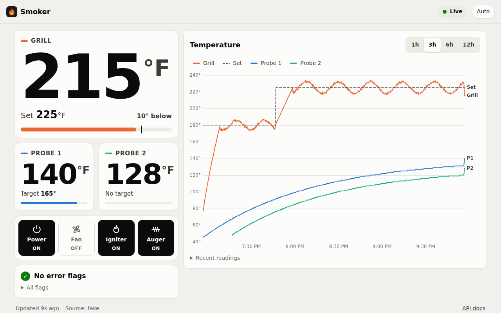

# Smokestack

A self-hosted dashboard and alert service for Pit Boss pellet grills (built and tested on the `PB850PS2`; other models: [Does my grill work?](docs/compatibility.md)). It polls the grill over WiFi or Bluetooth, stores the history in SQLite, and serves a live dashboard and a JSON API. Out of the box it is read-only; [grill control](docs/integrations.md#grill-control), off by default, adds turn-off, set-temperature, a °F/°C switch, a WiFi restart and a change of the grill's password. It can never turn the grill on.



The dashboard's look is the Smokestack-style design system in
[docs/design/](docs/design/README.md): dark first, high contrast for reading
the grill outdoors, Geist and Geist Mono served by the app itself, and one
ember accent that marks the grill. The theme button (Auto / Light / Dark) is
in the header.

## Quick start (Docker)

Runs on any always-on machine (NAS, mini-PC, Raspberry Pi). No Bluetooth adapter needed.

1. Get the compose file and settings:

   ```bash
   git clone https://github.com/iamstevedavis/smokestack.git && cd smokestack
   cp .env.example .env
   ```

2. Edit `.env`:
   - `PITBOSS_HOST`: the grill's IP. Find it in your router's DHCP list and
     give it a reservation so it doesn't change.
   - `PITBOSS_MODEL`: your model if it isn't the `PB850PS2`
     ([which names work](docs/compatibility.md)).
   - `PITBOSS_PASSWORD`: only if you set one on the grill.

3. Start it with the published image (amd64 or arm64):

   ```bash
   docker compose pull && docker compose up -d
   ```

4. Open `http://<server>:8000/`. Create the dashboard password when asked,
   and the dashboard shows live temperatures within a few seconds.

**No readings?** `curl http://<server>:8000/api/health` shows the bridge's
`last_error`. If it says it could not read the grill, first check that
`PITBOSS_HOST` is right and the grill is on. If it is, your grill probably
doesn't serve local HTTP and needs [Bluetooth](docs/ble.md) instead: on a
Linux host with Bluetooth, the same container can use it. Pick **Bluetooth**
under **Settings → Grill → Source**, or set `PITBOSS_SOURCE=ble` and
`PITBOSS_DEVICE_NAME` in `.env`.

No grill handy? Try the fake source: `PITBOSS_SOURCE=fake docker compose up -d`.

- To build from source instead, add `--build` to `docker compose up`.
- Data lives on the `smokestack-data` volume. Upgrading, backup and migration: [docs/docker.md](docs/docker.md).

## Security

- **The first visit asks you to create a password.** Until then the dashboard and API are locked. After that the password protects the dashboard, `/api/*` (except `/api/health`), the `/api/live` WebSocket and `/docs`. It is stored as a scrypt hash in the database, you can turn it off or back on under **Settings → Access & control**, and change it there too (it needs the current password). Sessions are signed cookies that last 30 days; the signing key is `session.key` next to the database (`/data` in Docker), and deleting it or changing the password signs everyone out.
- **Turning the password off opens everything to the LAN**, including the settings panel, so anyone there could point MQTT or ntfy at their own server and collect the saved secrets. It also switches grill control off.
- **Grill control is off by default.** With `SMOKESTACK_ENABLE_CONTROL` on, signed-in users can turn the grill off, set its temperature, switch its unit while it is off, restart its WiFi module and change the grill's password. Nothing can turn it on. Every command is logged in the database and must be confirmed on the dashboard; the log is under **Controls → Command log**. The password change asks for the dashboard password again, and the bridge keeps whichever password the grill accepts, so it cannot lock itself out.
- **Locked out?** Run `docker compose exec smokestack smokestack reset-password`, then `docker compose restart`. The next visit shows the setup screen again. Do this right after first start too if someone else might have reached the setup screen before you.
- **On plain HTTP the password and session cookie cross the LAN unencrypted.** That's fine for home use, but don't expose port 8000 to the internet: use a VPN (WireGuard, Tailscale), or put a TLS reverse proxy such as Caddy in front.
- The grill's local HTTP RPC exposes its configuration, including stored **WiFi credentials**, to anyone on the network. Keep the grill on an IoT VLAN that only the bridge host can reach. Details: [docs/testing/2026-10-18-cook-test.md](docs/testing/2026-10-18-cook-test.md).

## Configuration

Set these in `.env` (Docker) or the environment. Settings for the grill start with `PITBOSS_`; settings for Smokestack itself start with `SMOKESTACK_`.

| Variable | Default | Purpose |
| --- | --- | --- |
| `PITBOSS_SOURCE` | `fake` (`http` in Docker Compose) | `http` (WiFi), `ble` or `fake` |
| `PITBOSS_HOST` | | Grill LAN address for `http`, `host` or `host:port` |
| `PITBOSS_DEVICE_NAME` | | BLE device name for `ble` |
| `PITBOSS_PASSWORD` | | Grill password, if set |
| `PITBOSS_MODEL` | `PB850PS2` | Grill model |
| `SMOKESTACK_BLE_ADAPTER` | | Bluetooth adapter for `ble`, e.g. `hci1`, on hosts with more than one ([details](docs/ble.md#choosing-the-bluetooth-adapter)). Empty uses the system default |
| `SMOKESTACK_DB` | `data/smokestack.sqlite` | SQLite path (`/data/smokestack.sqlite` in Docker) |
| `SMOKESTACK_POLL_SECONDS` | `2` | Polling interval |
| `SMOKESTACK_STALE_AFTER_SECONDS` | `30` | Age at which a reading counts as stale |
| `SMOKESTACK_RETENTION_DAYS` | `0` | Delete data older than this; `0` keeps everything. The grill control log is kept |
| `SMOKESTACK_ENABLE_CONTROL` | `false` | Let signed-in users turn the grill off, set its temperature, restart its WiFi and change its password from the dashboard ([details](docs/integrations.md#grill-control)) |
| `SMOKESTACK_LOG_LEVEL` | `INFO` | Use `DEBUG` when troubleshooting |

Home Assistant (`SMOKESTACK_MQTT_*`) and ntfy alerts (`SMOKESTACK_NTFY_*`, `SMOKESTACK_ALERT_*`) are optional and off by default. Every variable and its default is listed in [docs/integrations.md](docs/integrations.md#settings).

### Changing settings from the dashboard

The wrench button opens a settings panel with a side list of sections: **Grill**, **Alerts**, **Home Assistant**, **Access & control** and **System**. Each entry shows its current state, such as the source or whether an integration is on. On a phone the section list comes first, then one section full screen with **Back**.

- **Save as you go.** There is no Save button: a text or number field saves when it loses focus, if its value changed, and switches, source cards and selects save as soon as they change. A saved field shows **Saved** for a moment. A rejected value shows the bridge's error under the field and keeps what you typed.
- Changing the connection (source, address, Bluetooth name or adapter, or grill password) reconnects the bridge to the grill. Other changes apply without a container restart, and the page stays up.
- **Precedence:** built-in default, then `.env`/environment, then values saved in the panel. Saved values win.
- Saved values live in the SQLite database in the data volume (`/data` in Docker), so they survive restarts and upgrades. Only fields that differ from the default are marked: **Custom** with **Reset** for a saved value, "from .env" for one from the environment. **Reset** drops the saved value and falls back to `.env` or the default.
- The panel shows only the fields the chosen source uses: the grill address for WiFi, the Bluetooth name and adapter for Bluetooth, and neither for Demo.
- MQTT and ntfy each have a switch. Turning one off keeps its host or URL, so turning it back on just works. An integration runs only while it is on and its host or URL is set.
- **Alerts** has a **Send test alert** button that uses the saved ntfy URL and token, and shows the error ntfy gives if it fails.
- Passwords and tokens are write-only: the panel shows whether they are set, never their value.
- **Access & control** turns the dashboard password off or on at once and changes it. **Grill control** there is off until the password is on, and links to the command log.
- **System** keeps the history, log level and version. **Env only:** `SMOKESTACK_DB`, `SMOKESTACK_PORT` and `SMOKESTACK_START_COLLECTOR`, listed under **Set only in .env** there.
- The source list only offers what can actually run: `fake` and `http` (WiFi) always, and `ble` only when the host's Bluetooth is reachable: a Linux host with `bluetoothd` running ([docs/ble.md](docs/ble.md)). With Docker Compose that's the same container either way, so switching between WiFi and Bluetooth is just a setting.

## More

- [API reference](docs/api.md): history, cook sessions, settings, health
- [Home Assistant and alerts](docs/integrations.md)
- [Does my grill work?](docs/compatibility.md): tested models, WiFi or Bluetooth
- [Bluetooth setup](docs/ble.md)
- [Docker operations](docs/docker.md): upgrade, backup, migrating the old `./data` mount
- [Releasing](docs/releasing.md): versions, tags, release notes and images
- [Design](docs/design/README.md): the dashboard's design system, Smokestack-style

## Development

```bash
python -m venv .venv && . .venv/bin/activate
python -m pip install -e ".[test]"
pytest
PITBOSS_SOURCE=fake uvicorn smokestack.api:create_app --factory --reload
```

Development needs Python 3.12 or 3.13. On Windows, run this inside WSL2 (Ubuntu). The dashboard is plain HTML/CSS/JS in `src/smokestack/static/` with no build step.

## License

[AGPL-3.0-or-later](LICENSE). You can use, change and share it freely. If you
run a modified version as a service for other people, you must offer them its
source.

## Credits

Grill communication comes from [pytboss](https://github.com/dknowles2/pytboss)
(Apache-2.0) by David Knowles.

Smokestack is an independent project, not affiliated with or endorsed by
Dansons or Pit Boss. Pit Boss is a trademark of its owner, used here only to
say which grills this works with.
